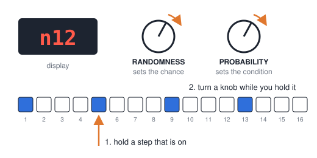
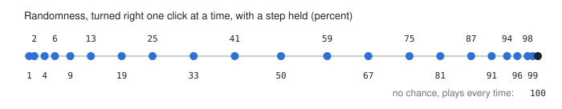
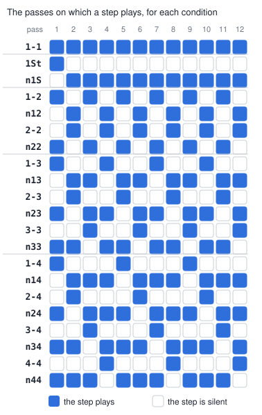
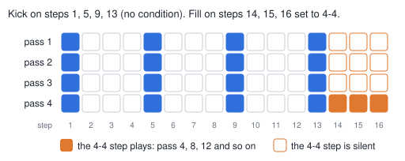

# Step chance and conditions

This guide is for version 1.2.1 of the mod "Step chance and conditions". The
[patch page](https://angellinares.github.io/bstp_firmware_explore/) installs
it on a BeatStep Pro with firmware 2.0.1.6.

In the stock firmware, a step that is on plays each time the pattern comes
round. The mod adds two ways to make a step play only some of the time:

- A **chance** makes the step play at random, for example about half the
  times.
- A **condition** makes the step play on fixed passes of the pattern, so the
  result is the same each time you play it.

A step has a chance or a condition, not both. Steps that you do not change
play as before.

## Words in this guide

- **Pass**: one time through the pattern. In a 16-step pattern, pass 1 is the
  first 16 steps after you press Play. Pass 2 is the next 16 steps.
- **Hold a step**: push a step button and keep it pushed.
- **Randomness** and **Probability**: the two knobs with these names on the
  panel.

The knob names do not match the functions. The Randomness knob sets the
chance. The Probability knob sets the condition.

## Set a chance

1. Select the track: SEQ1, SEQ2 or DRUM.
2. On the DRUM track, select the pad.
3. Hold a step that is on.
4. Turn the Randomness knob while you hold the step.
5. Read the chance on the display, in percent.
6. Release the step.

The step stays on after you release it.

A chance of 50 makes the step play about half the times it comes round. A
chance of 25 makes it play about one time in four. The mod decides again each
time the step comes round.

The chance has 21 values from 1 to 99. The values are closer together near
1 and near 99. One click of the knob moves to the next value.

To remove the chance, turn Randomness to the right until the display shows
100. A step with a chance of 100 is a normal step.

When you hold no step, the Randomness knob does its stock function.

## Set a condition

1. Select the track: SEQ1, SEQ2 or DRUM.
2. On the DRUM track, select the pad.
3. Hold a step that is on.
4. Turn the Probability knob while you hold the step.
5. Read the condition on the display.
6. Release the step.

To remove the condition, turn Probability to the left until the display shows
`1-1`.

When you hold no step, the Probability knob does its stock function.

### The order of the conditions

When you turn Probability to the right, the display shows the conditions in
this order:

`1-1`, `1St`, `n1S`, `1-2`, `n12`, `2-2`, `n22`, `1-3`, `n13`, `2-3`, `n23`,
`3-3`, `n33`, `1-4`, `n14`, `2-4`, `n24`, `3-4`, `n34`, `4-4`, `n44`

### How to read a condition

- `1-1` is no condition. The step plays on each pass.
- `1St` plays on pass 1 only.
- `n1S` plays on each pass except pass 1.
- `A-B` counts the passes in groups of B. The step plays on pass A of each
  group.
- `nAB` is the opposite of `A-B`. The step plays on each pass except the pass
  that `A-B` plays on.

Some examples:

- `1-2` plays on passes 1, 3, 5, 7 and so on.
- `2-2` plays on passes 2, 4, 6, 8 and so on.
- `1-4` plays on passes 1, 5, 9 and so on.
- `4-4` plays on passes 4, 8, 12 and so on.
- `n14` plays on passes 2, 3, 4, then 6, 7, 8.
- `n44` plays on passes 1, 2, 3, then 5, 6, 7.

The figure shows all 21 conditions for the first 12 passes.

| Display | The step plays on passes |
|---|---|
| `1-1` | all |
| `1St` | 1 only |
| `n1S` | all except 1 |
| `1-2` | 1, 3, 5, 7 ... |
| `n12` | 2, 4, 6, 8 ... |
| `2-2` | 2, 4, 6, 8 ... |
| `n22` | 1, 3, 5, 7 ... |
| `1-3` | 1, 4, 7, 10 ... |
| `n13` | 2, 3, 5, 6, 8, 9 ... |
| `2-3` | 2, 5, 8, 11 ... |
| `n23` | 1, 3, 4, 6, 7, 9 ... |
| `3-3` | 3, 6, 9, 12 ... |
| `n33` | 1, 2, 4, 5, 7, 8 ... |
| `1-4` | 1, 5, 9 ... |
| `n14` | 2, 3, 4, 6, 7, 8 ... |
| `2-4` | 2, 6, 10 ... |
| `n24` | 1, 3, 4, 5, 7, 8 ... |
| `3-4` | 3, 7, 11 ... |
| `n34` | 1, 2, 4, 5, 6, 8 ... |
| `4-4` | 4, 8, 12 ... |
| `n44` | 1, 2, 3, 5, 6, 7 ... |

`n12` and `2-2` play on the same passes. `n22` and `1-2` also play on the same
passes.

## Chance and condition on one step

A step keeps only the last of the two that you set.

- If a step has a condition, Randomness shows 100. Turn Randomness to the left
  to set a chance. The chance replaces the condition.
- If a step has a chance, Probability shows `1-1`. Turn Probability to the
  right to set a condition. The condition replaces the chance.

## How the mod counts passes

- The count starts at pass 1 when you press Play from stop.
- The count starts at pass 1 again when the pattern changes.
- SEQ1 and SEQ2 each count their own passes. Tracks of different lengths
  drift against each other, as in the stock firmware.
- On the DRUM track, the step buttons show the steps of the selected pad. The
  chance and the condition that you set belong to that pad.
- Each drum pad counts the passes of its own length.
- In the alternate direction, one pass is the way there and the way back.

## Examples

**A fill at the end of each fourth bar.** Set the steps of the fill to `4-4`.

**A phrase that is longer than the pattern.** Set some steps of a 16-step
pattern to `1-2` and others to `2-2`. The result is a 32-step phrase. With
`1-4`, `2-4`, `3-4` and `4-4`, the result is a 64-step phrase.

**An intro that plays one time.** Set its steps to `1St`.

**A part that starts on the second pass.** Set its steps to `n1S`.

**Hi-hats or ghost notes that change.** Set a chance from 50 to 75.

## Saving and copying

- When you save the project, the mod saves the chances and the conditions with
  the pattern.
- When you turn a step off, the step loses its chance or condition.
- The stock functions that shift or copy steps also remove them.
- When you copy a pattern or a project, the copy keeps them.
- Arturia's firmware ignores them. After you go back to the stock firmware, a
  pattern saved with the mod plays each step that is on again.

## What is not yet checked on a device

The mod runs on one unit. These functions have no report from a device yet:

- swing
- drum shift
- reverse and alternate direction
- pattern change while the sequencer plays
- copy project
- long use

The figures come from `tools/gen_figures.py`. The script reads the chance
values and the conditions from `patches/trig.c`.
